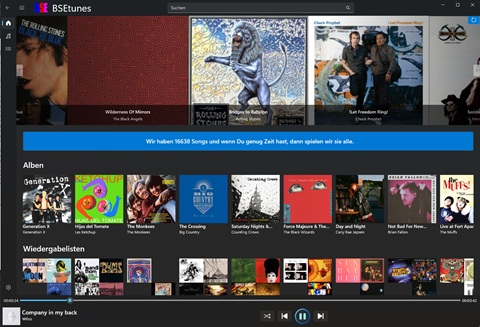

# {{ page.title}}

{{page.description}}

The application focuses on comfortable everyday listening while keeping the system private and controlled. Users can browse and play single songs, start complete albums, use their own playlists, and enjoy randomized playback across selected BSEtunes content.

Authentication is required to connect to the backend, so access is restricted to authorized users managed by the server operator.

Main features
- **Modern WinUI 3 desktop experience** (replacement for the legacy UWP client)
- **Track playback** for individual songs
- **Album playback** from start to finish
- **Playlist support** for self-created listening collections
- **Random playback** over selected library content
- **Secure, login-based access** to the private BSEtunes server
- **Multilingual UI** with **German** and **English** support

Role in the BSEtunes system

The client is one part of the full BSE stack, which also includes:
- the **BSEadmin** tool for managing music content, and
- the **BSEtunes Web API** backend for streaming and data access.
- the **BSE.Identity** user management application
- the **BSEtunes MAUI** client for ios and android

## Important!!

Due to copyright restrictions on the streamed music files, server load, and potentially limited bandwidth during server operation, a connection without a login is not possible. Therefore, you need a user account to connect to our server.

- You are not able to register yourself as a user via the app, your will be invited.
- A registration can only be done by the operator of the BSEtunes server.

## Questions??
If you have questions, [here's]({{site.repositories.bsetunes_maui}}) the source code. 

## Downloads

#### Windows Devices

<a href="https://github.com/uwe-e/BSE.Tunes.Client/releases/download/v1.0.8/BSE.Tunes.WinUI.Client_1.0.1.0_x64.msix">click to install it on a Windows device</a>

#### IOS Devices
Registered users can install an adhoc distribution version of the app.

<a href="itms-services://?action=download-manifest&url=https://github.com/uwe-e/BSE.Tunes.Client/releases/download/v1.0.7/manifest.plist">click to install it on an Apple device</a>

#### Android Devices

<a href="https://github.com/uwe-e/BSE.Tunes.Client/releases/download/v1.0.7/com.bsetunes.bse.tunes.maui.client.apk">click to install it on an Android device</a>